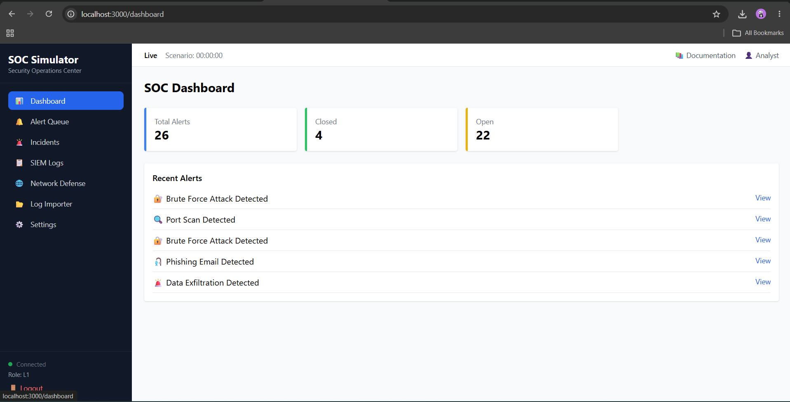
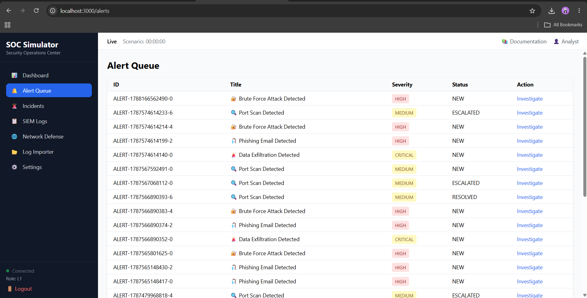
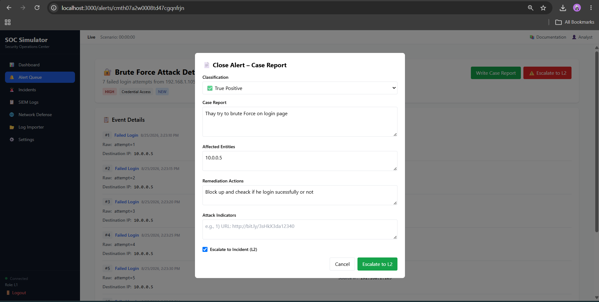
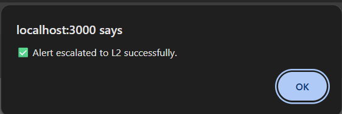
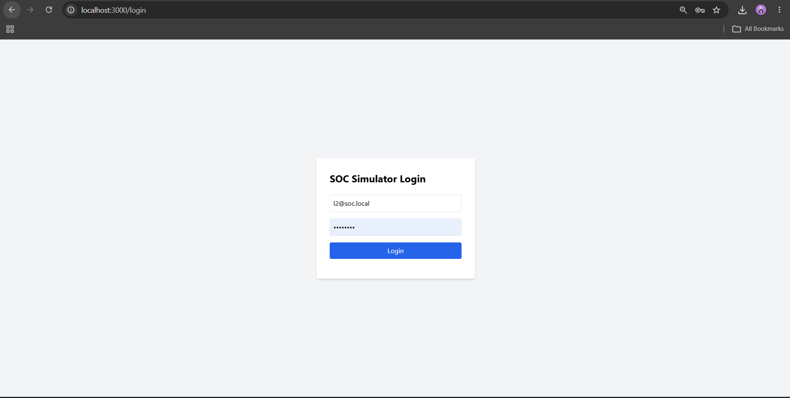
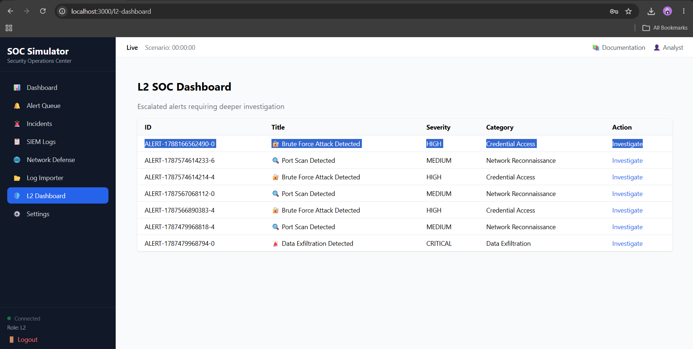
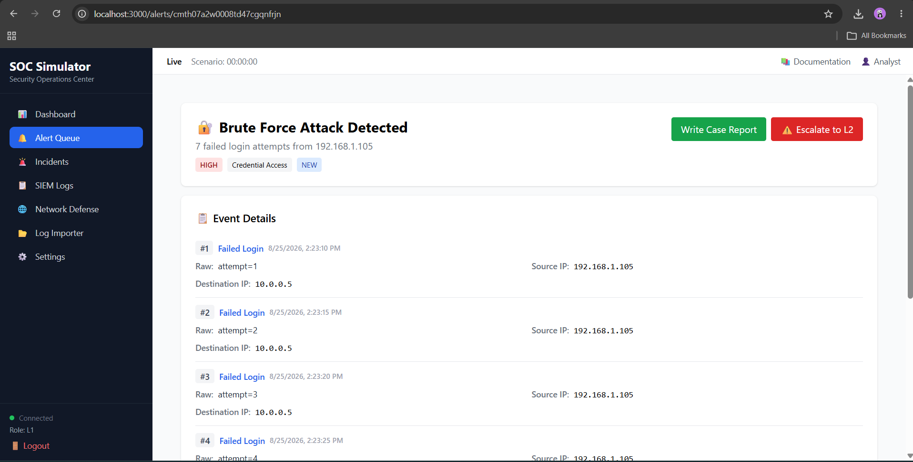
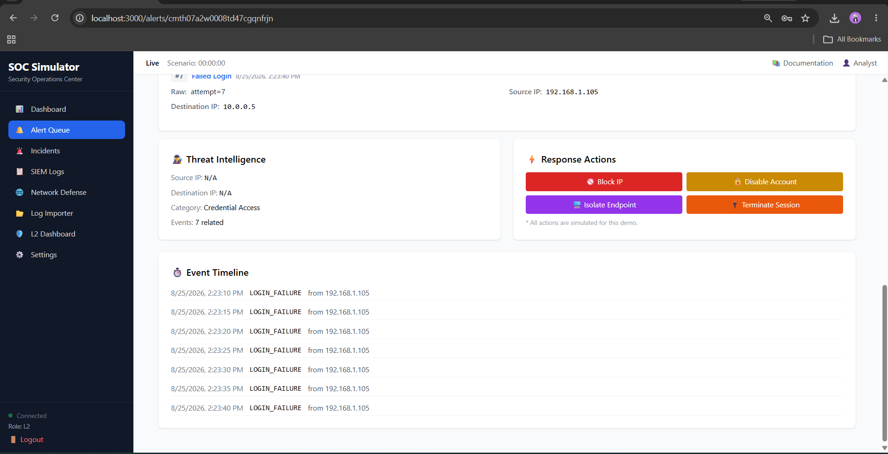
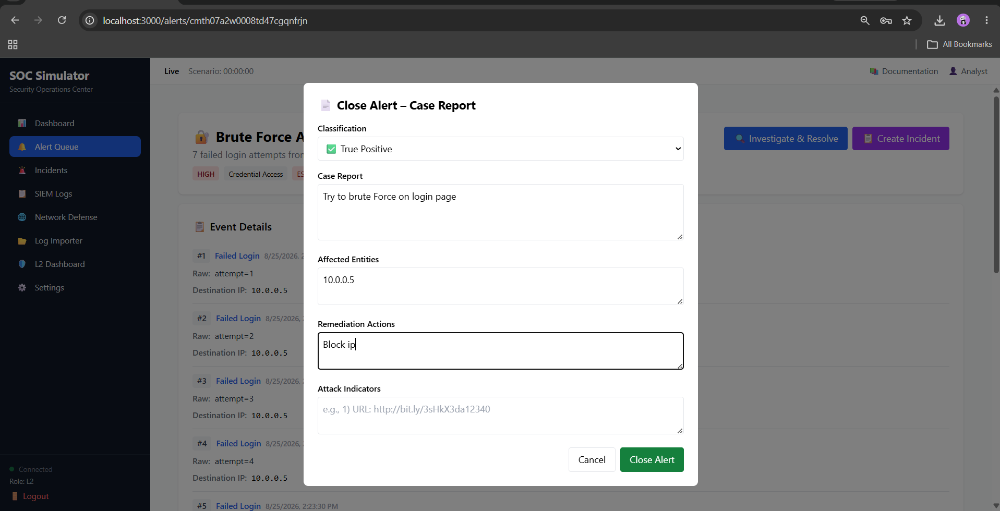

# SOC Simulator

**L1 → L2 Alert Investigation, Escalation & Incident Resolution**

**Walkthrough Name:** SOC Alert Investigation, L2 Escalation & Incident Resolution

**Prepared by:** Smit Kyada

**Scenario:** Brute Force Attack Detection & Response

This document demonstrates the complete SOC workflow shown in the supplied screenshots.

---

## 1. Workflow Overview

L1 Analyst → SOC Dashboard → Alert Queue → Investigate → Review Events → True Positive Classification → Case Report → Escalate to L2 → L2 Analyst → L2 Dashboard → Deeper Investigation → Threat Intelligence → Response Actions → Final Case Report → Close Alert

| Stage | Main Activity |
|---|---|
| L1 Triage | Review alerts and identify suspicious authentication activity |
| Investigation | Analyze seven failed-login events from the same source |
| Escalation | Document findings and escalate the True Positive to L2 |
| L2 Analysis | Review the escalated alert, timeline, and response options |
| Resolution | Document remediation and close the alert |

---

## Step 1 — L1 SOC Dashboard

The L1 analyst begins on the SOC Dashboard and reviews the alert overview, including total, open, and closed alerts and the recent alert list.

*Screenshot 1 of 10*

---

## Step 2 — Alert Queue

The Alert Queue lists the detected security alerts with their IDs, titles, severity, status, and an Investigate action. The brute-force alert is selected for investigation.

*Screenshot 2 of 10*

---

## Step 3 — Initial Alert Investigation

The alert details show a Brute Force Attack Detected alert with HIGH severity, Credential Access classification, seven failed login attempts, source IP 192.168.1.105, and destination IP 10.0.0.5.

*Screenshot 3 of 10*

---

## Step 4 — L1 Case Report & Escalation

The L1 analyst classifies the alert as a True Positive, records the case report and affected entity, specifies remediation, and selects Escalate to Incident (L2).

*Screenshot 4 of 10*

---

## Step 5 — L2 Escalation Confirmation

The simulator confirms that the alert was escalated to L2 successfully.

*Screenshot 5 of 10*

---

## Step 6 — L2 Analyst Login

The L2 analyst signs in to the SOC Simulator using the L2 account to continue the investigation.

*Screenshot 6 of 10*

---

## Step 7 — L2 SOC Dashboard

The L2 Dashboard displays escalated alerts requiring deeper investigation. The previously escalated brute-force alert is visible in the queue.

*Screenshot 7 of 10*

---

## Step 8 — L2 Alert Investigation

The L2 analyst opens the escalated brute-force alert and reviews its severity, category, source/destination IPs, and seven failed-login events.

*Screenshot 8 of 10*

---

## Step 9 — Threat Intelligence & Response Actions

The L2 investigation includes Threat Intelligence, the event timeline, and simulated response actions such as Block IP, Disable Account, Isolate Endpoint, and Terminate Session.

*Screenshot 9 of 10*

---

## Step 10 — Final Case Report & Closure

The L2 analyst documents the final investigation, affected entity, and remediation action, then closes the alert.

*Screenshot 10 of 10*

---

## 11. Skills Demonstrated

This walkthrough demonstrates practical SOC Analyst activities including:

- Alert monitoring and triage
- Brute-force attack identification
- Authentication event analysis
- Source and destination IP analysis
- True-positive classification
- SOC case report writing
- L1-to-L2 escalation
- L2 alert investigation
- Event timeline analysis
- Threat intelligence review
- Incident response decision-making
- Alert closure and documentation

**Prepared by:** Smit Kyada

**Walkthrough:** SOC Alert Investigation, L2 Escalation & Incident Resolution
